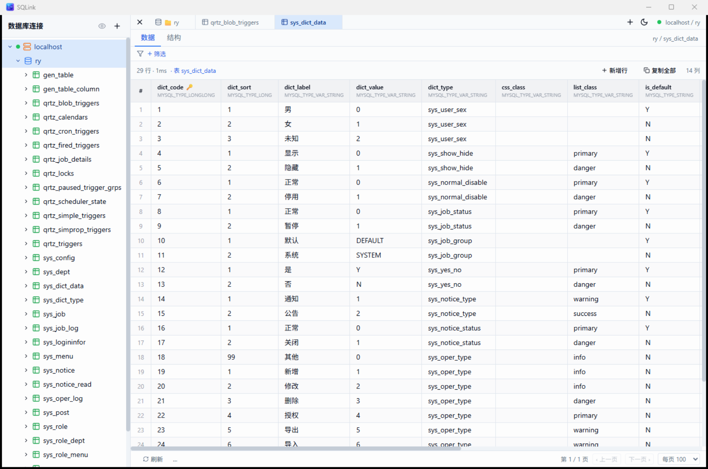
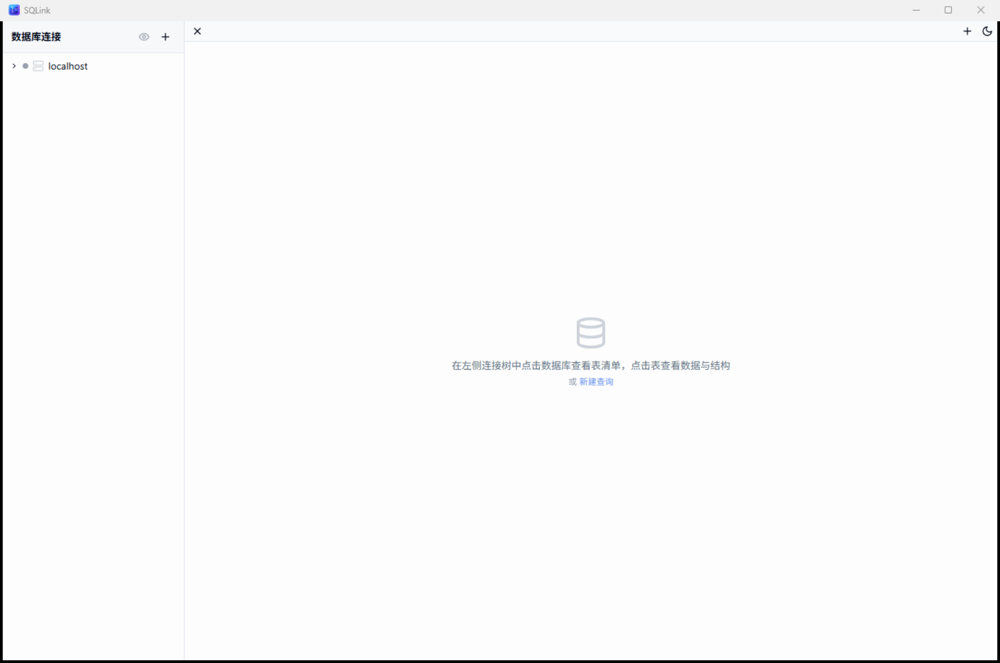

<p align="center">
  
</p>

<h1 align="center">SQLink</h1>

<p align="center">
  跨平台桌面数据库管理工具 · Tauri 2 + React + Rust
</p>

<p align="center">
  
  
  
  
</p>

---

## 简介

SQLink 是一个轻量、快速、跨平台的数据库客户端，基于 **Tauri 2**（Rust 后端 + WebView 前端）构建。相比 Electron 方案，安装包更小、内存占用更低、启动更快；相比重量级 IDE，界面更聚焦日常的数据库浏览、查询和编辑工作。

## 界面预览

<p align="center">
  
</p>
<p align="center"><i>数据网格：连接树、可视化筛选、分页浏览、行内编辑</i></p>

<p align="center">
  
</p>
<p align="center"><i>新建连接：MySQL / PostgreSQL / SQLite / SQL Server，密码加密存储</i></p>

<p align="center">
  
</p>
<p align="center"><i>主界面：简洁的多标签工作台</i></p>

## 支持的数据库

| 数据库 | 驱动 | 说明 |
| --- | --- | --- |
| MySQL / MariaDB | `mysql_async` | 支持 GBK/GB18030 老库列解码 |
| PostgreSQL | `tokio-postgres` | 跨库惰性连接缓存、查询取消（CancelToken） |
| SQLite | `rusqlite`（bundled） | 本地文件库，支持查询中断（interrupt） |
| SQL Server | `tiberius`（TDS 协议） | rustls 加密、信任自签名证书（暂不支持取消查询） |

## 功能特性

### 连接管理
- 连接树：扁平化连接列表，点击未连接的配置即自动建连
- 连接配置本地持久化，密码 **AES-256-GCM 加密**落盘，永不下发前端
- 系统数据库（`information_schema` / `master` / `template0` 等）默认隐藏，可通过眼睛按钮或右键菜单切换显示；系统库禁止新建表、导入、删除等危险操作
- 连接颜色标记、编辑、断开、删除

### 数据浏览与编辑
- 表数据网格：分页浏览、行数统计
- 可视化筛选栏：多条件组合（等于 / 包含 / 大于 / 为空等）
- 单表 SELECT 结果集可直接**在网格里编辑**，事务批量提交，失败整体回滚
- 数据和结构独立刷新

### 结构管理
- 新建数据库对话框（按方言生成：MySQL 字符集 / PG 编码 / SQL Server 排序规则）
- 可视化**新建表设计器**：列、索引、外键、主键、默认值、注释，实时 SQL 预览
- 已有表的结构编辑（ALTER），按数据库方言生成对应语句
- 索引 / 外键 / 列注释查看

### SQL 编辑器
- Monaco 编辑器（VS Code 同款）：SQL 高亮、自动补全
- 执行选中 / 执行全部、查询取消（MySQL KILL QUERY / PG CancelToken / SQLite interrupt）
- 执行耗时、影响行数、截断提示
- 查询历史面板：自动记录执行成功的语句（时间/耗时/行数），点击回填编辑器，支持删单条与清空

### 导入导出
- **导入 SQL 文件**：流式拆分大文件（正确处理字符串、注释里的分号），支持"覆盖已存在的表"策略
- **转储 SQL 文件**：整库或单表导出 DDL + INSERT（分批 100 行/条）
- **导出 CSV**：整表导出，不受查询行数上限限制

### 界面体验
- 深色 / 浅色主题一键切换，Windows 系统标题栏随主题联动变色
- 浅色主题以白底浅蓝为主，深色主题为纯灰阶
- 工作台多标签页：标签栏空间不足时先压缩标签，压缩到极限后出现左右移动按钮
- 标签右键菜单：关闭 / 关闭其他 / 关闭全部
- 全局禁用 WebView 默认右键菜单，应用内右键均为功能菜单

## 技术栈

| 层 | 技术 |
| --- | --- |
| 后端 | Rust · Tauri 2 · tokio · async-trait |
| 前端 | React 18 · TypeScript · Vite · Tailwind CSS · Zustand · Monaco Editor |
| 驱动 | mysql_async · tokio-postgres · rusqlite · tiberius |
| 安全 | AES-256-GCM（连接密码加密存储） |

后端采用 trait 驱动的多数据库抽象（`DatabaseDriver`），每种数据库一个独立驱动文件，新增数据库类型只需实现同一套接口。

## 快速开始

### 环境要求

- [Node.js](https://nodejs.org/) 18+
- [Rust](https://rustup.rs/) 1.78+
- Tauri 2 系统依赖（Windows 需 [WebView2](https://developer.microsoft.com/microsoft-edge/webview2/)，一般系统自带）

### 开发模式

```bash
# 安装前端依赖
npm install

# 启动开发模式（Vite 热更新 + Tauri 窗口）
npm run tauri dev
```

### 构建发布

```bash
# 产出安装包（Windows 为 .msi / .exe NSIS 安装器）
npm run tauri build
```

构建产物位于 `src-tauri/target/release/bundle/`。

### 仅编译后端

```bash
cd src-tauri
cargo build          # debug
cargo build --release
cargo test           # 运行单元测试（SQL 导入拆分器等）
```

## 项目结构

```
sqlconnect/
├── src/                        # 前端（React）
│   ├── components/             # 界面组件
│   │   ├── connection/         # 连接树、连接/建库/导入/导出对话框
│   │   ├── editor/             # Monaco SQL 编辑器
│   │   └── result/             # 结果网格（可编辑）
│   ├── lib/                    # DDL 语句生成（四方言）、工具函数
│   ├── stores/                 # Zustand 状态（连接/编辑器/工作区/主题）
│   └── services/               # Tauri IPC 封装
├── src-tauri/                  # 后端（Rust）
│   └── src/
│       ├── database/           # DatabaseDriver trait + 四种驱动实现
│       │   ├── mysql.rs
│       │   ├── postgres.rs
│       │   ├── sqlite.rs
│       │   ├── mssql.rs
│       │   └── dump.rs         # SQL 流式拆分 / INSERT 批量生成
│       ├── commands/           # Tauri 命令（连接/查询/导入导出/窗口）
│       └── store.rs            # 连接配置加密持久化
└── src-tauri/icons/            # 应用图标（全平台尺寸）
```

## 路线图

- [ ] SQL Server 查询取消
- [x] 查询历史（成功语句按连接记录，面板回填/删除/清空）
- [ ] SQL 收藏
- [ ] 表数据导入（CSV → 表）
- [ ] ER 关系图
- [ ] 更多数据库（Oracle / Redis / ClickHouse…）

## License

MIT
